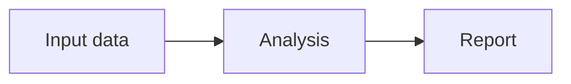

Use a diagram when its relationships are easier to understand visually. Prose,
a list or a table can be a better answer; the availability of this skill is not
a requirement to draw something.

CLIO renders Mermaid source with bundled Pele: Pele is the rendering engine,
not a different component or a JavaScript API the agent needs to call. Keep the
`mermaid` fence and `clio.mermaid.v1` component name. CLIO retains compatibility
rendering for existing Mermaid documents. It handles flowcharts, sequences, git graphs,
mindmaps, states, timelines, railroad grammars and other supported diagram types.
The renderer adapts to the viewing width and active theme. Do not install a browser,
fetch a CDN or embed renderer code merely to display an ordinary diagram.

Choose the form that expresses the relationship: a sequence for a protocol,
a git graph for branches and merges, a mindmap for a hierarchy, a railroad for
a grammar, or a flowchart for stages and decisions. Keep quantitative evidence
in CLIO's chart/data views when their filtering, units and shared selection help.
Authored HTML/SVG remains available for a custom illustration or interaction;
use the declared file tools and normal artifact registration for that result.

For engine differences, theme/size behavior, CLIO's input shape and recovery,
load `references/pele-in-clio.md`. For concrete syntax, load
`references/diagram-examples.md` when useful. It has
small rendered examples of flowcharts, sequences, git graphs, mindmaps and
Pele's `railroad-ebnf-beta` grammar; no need to load every example for each diagram.

For a small explanation, use a `mermaid` code block. For an interactive report,
load the active catalog's `clio.mermaid.v1` contract and use inline `source` or
`dataUri` for a registered source file. Use `create-dashboard` for a saved report.
Give wide workflows a full-width panel when needed. Equal and uneven columns
are both options; neither is a default composition rule. Keep labels concise
without hiding distinctions or inventing stages, paths or measurements.

Folder navigation is explicit and uses the current workspace's existing access:

Inspect the real workspace before authoring these targets. Each target is a
relative directory path; percent-encode reserved characters. CLIO opens the
folder in Files when the person clicks the corresponding node. This is guarded
navigation, not an executable Mermaid callback. Arbitrary click handlers, HTML,
init directives, external URLs and paths outside the workspace are not folder
targets. Navigation does not grant permissions or run commands. A plain export
retains the diagram; folder navigation needs an open workspace.

For substantial diagrams and dashboards, load `review-visual-presentation`.
Inspect the actual captured image at the person's viewing width, identify
cropping, unreadable text, unused space or misleading relationships, revise,
and inspect a fresh capture. Keep graph structure and any folder targets intact.
The raw source and a successful render are not evidence that the result is clear.
A hand-authored gallery checks the renderer, not your ability to interpret the
person's request. Review the artifact you actually authored from their material;
distinguish a synthetic example, a real agent run and a production-data workflow.
