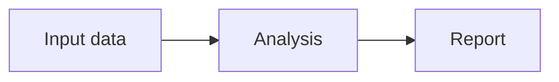
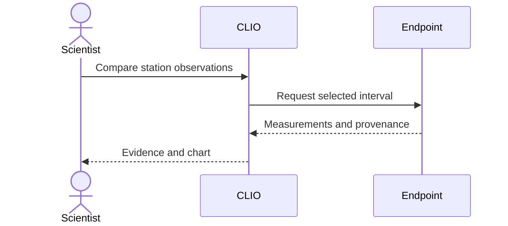
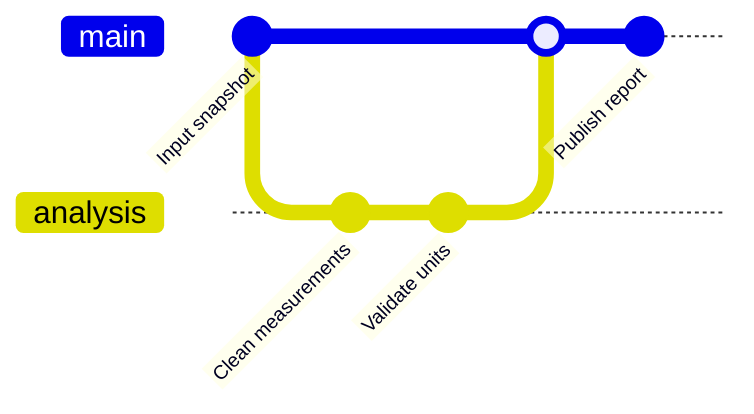
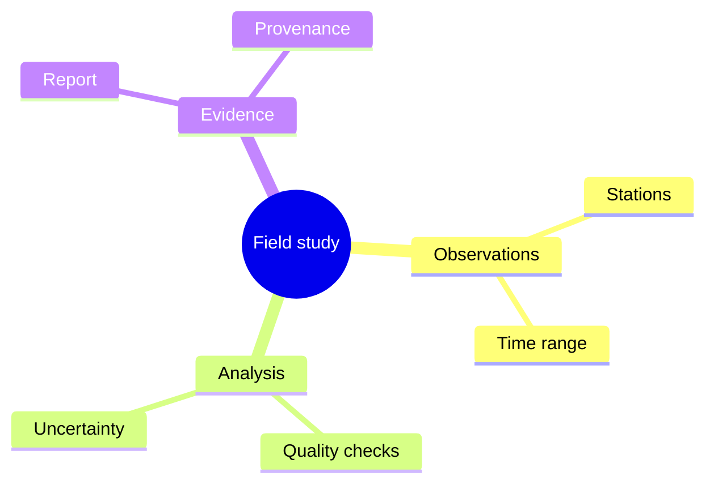

# Diagram syntax examples

These small synthetic examples have been rendered with CLIO's bundled Pele.
Choose the form that helps the explanation. Prose, a list or a table may be clearer.
Default diagram styling follows the active theme; colour can carry meaning when
the explanation needs it, rather than serving as a required decoration.

## Flowchart: stages and dependencies



Give a wide flowchart enough width, or choose a top-down `TB` layout when that
fits the relationship and viewing space better. The folder-navigation example
in the main skill adds explicit targets to existing workspace directories.

## Sequence: participants and messages



## Git graph: branches and merges



## Mindmap: a hierarchy



## Railroad: a grammar

Use Pele's EBNF diagram declaration, not an invented `railroadDiagram` keyword.
These are grammar productions, rather than workflow nodes:

```mermaid
railroad-ebnf-beta
query = "SELECT" fields "FROM" source [ "WHERE" predicate ] ;
fields = name ( "," name )* ;
```

For a substantial deliverable, inspect an actual image of the resulting diagram,
fix concrete readability or cropping defects, and inspect a new capture.
